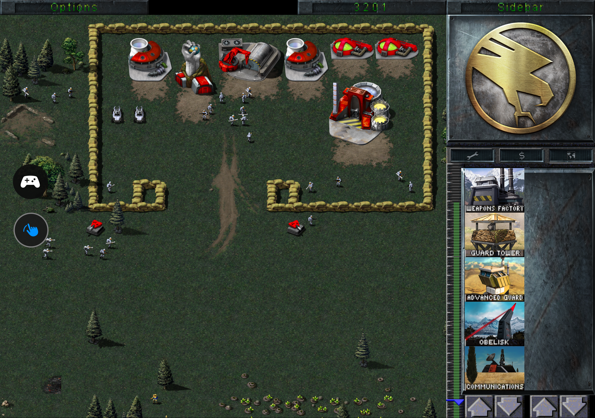
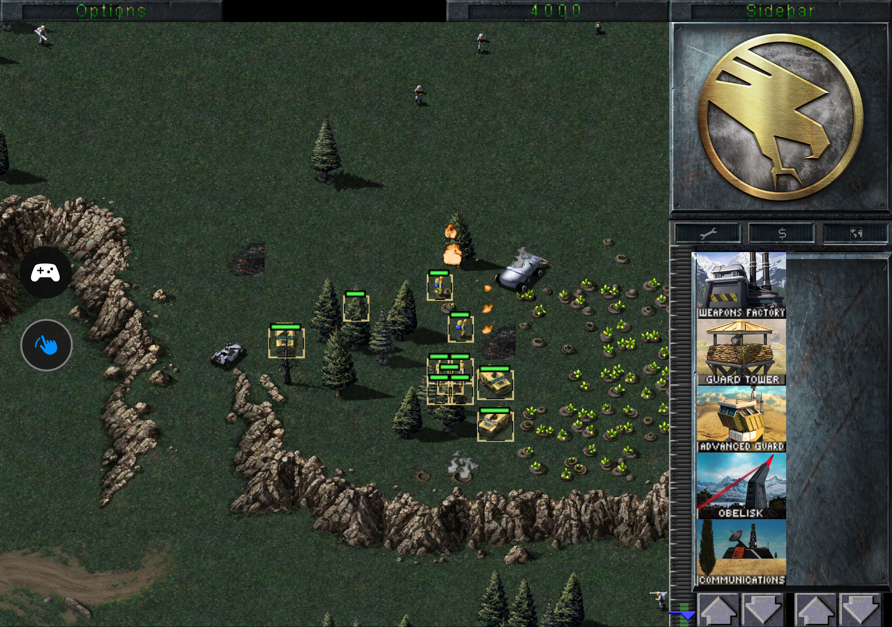
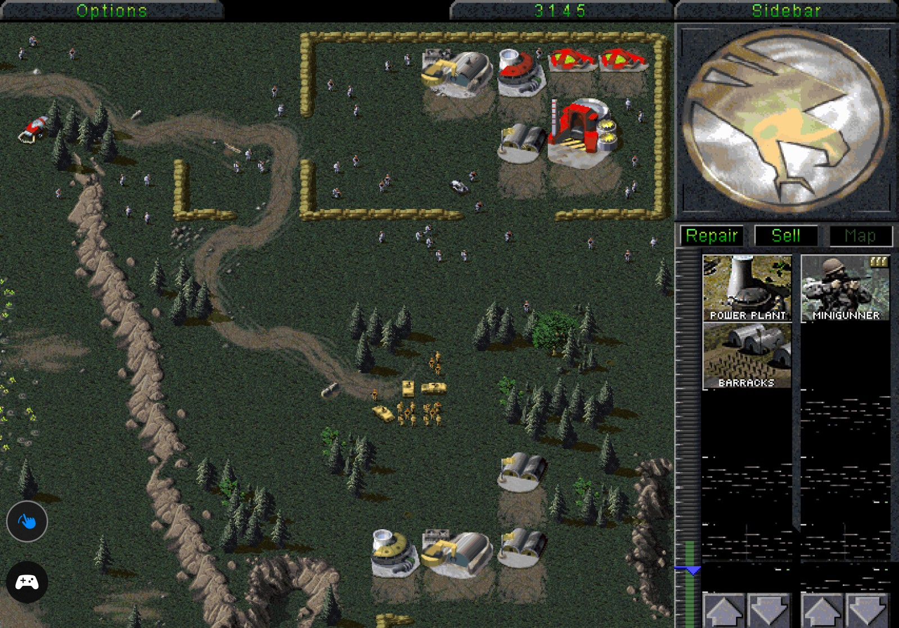
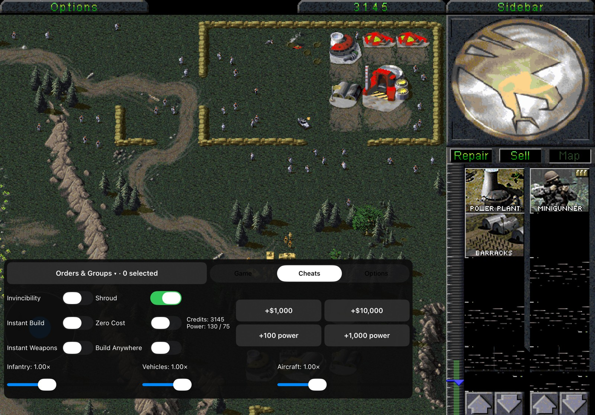
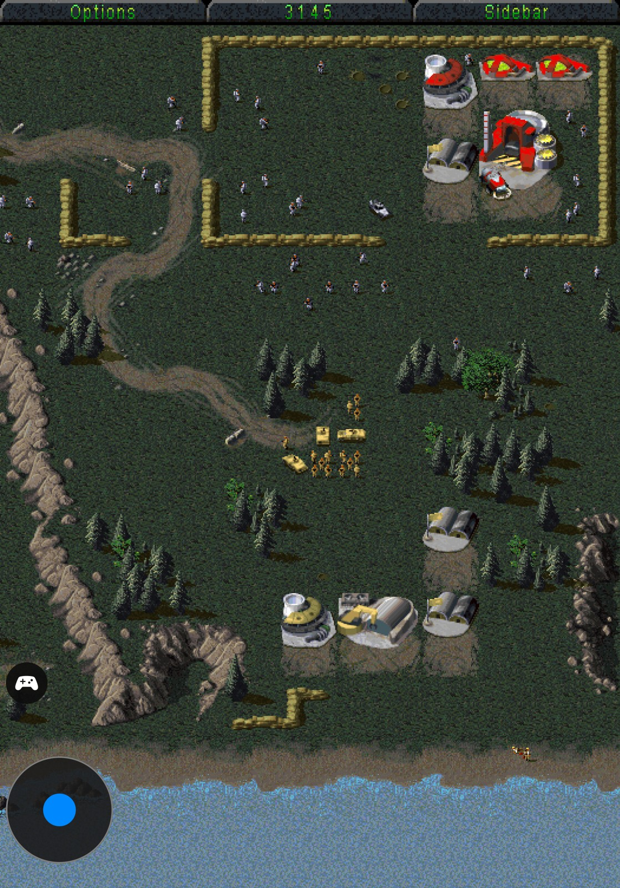
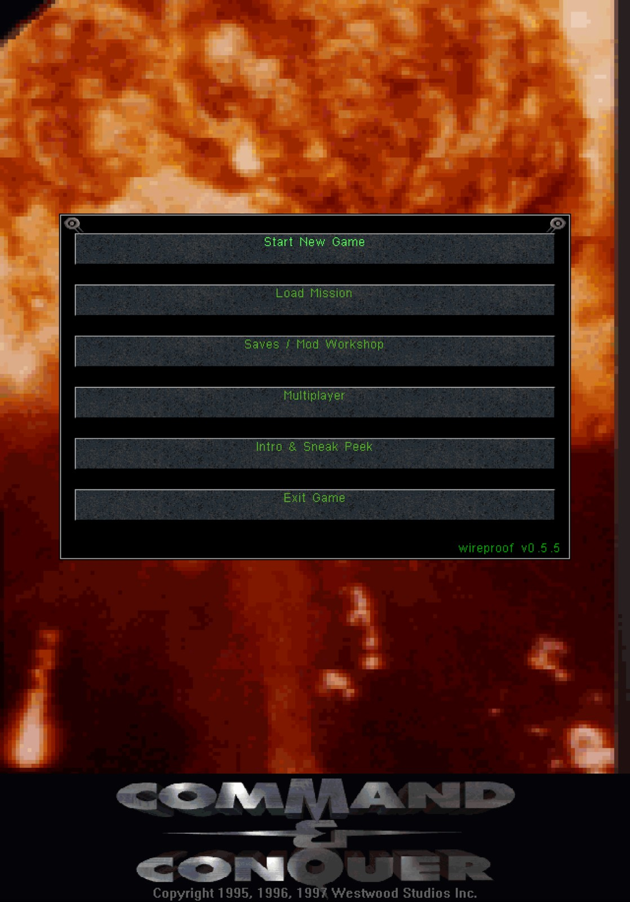
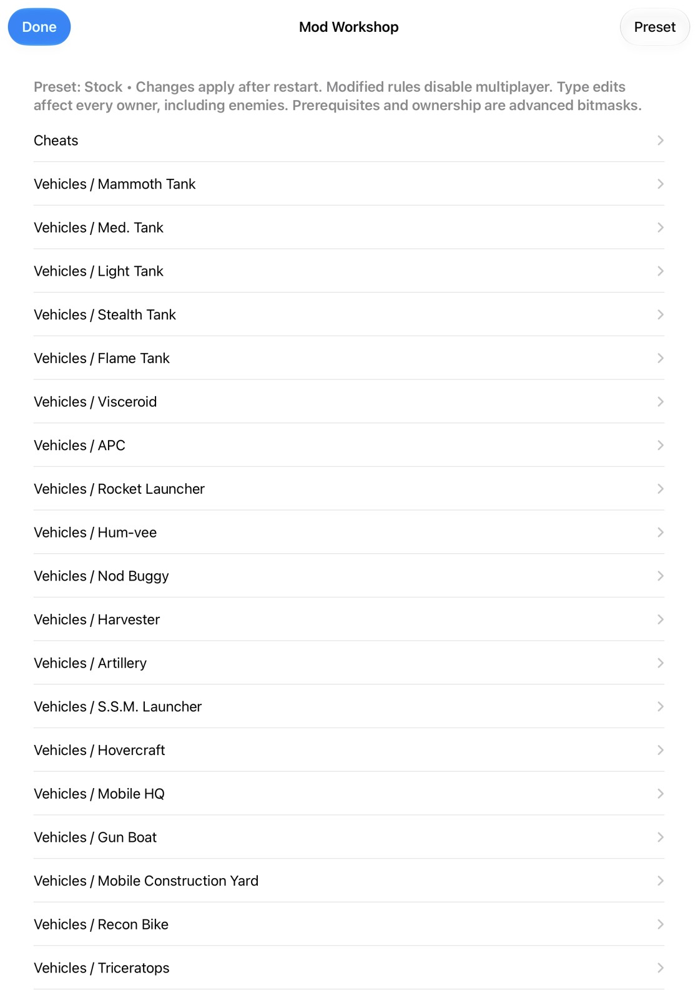

# Tiberian Dawn — Wireproof

Classic Command & Conquer, adapted for touch on iPhone and iPad and native play on macOS. Built on [Cesarus85’s Apple port](https://github.com/Cesarus85/Tiberian-Dawn-for-iPad-and-macOS), [Vanilla Conquer](https://github.com/TheAssemblyArmada/Vanilla-Conquer), and EA’s released source.

**[Latest release](https://github.com/wireproof/Tiberian-Dawn/releases/latest) · [Report a bug or request a feature](https://github.com/wireproof/Tiberian-Dawn/issues) · [Gameplay and screenshots](docs/showcase/README.md)**

An unofficial, free, non-commercial community project. **EA has not endorsed and does not support this product.**

## Current release — v0.7.3

**Build 703 is installed on the owner's iPad and Duo. Gameplay fixes are awaiting device verification.** [Release notes](https://github.com/wireproof/Tiberian-Dawn/releases/tag/v0.7.3) · [Device test checklist](docs/TESTING-0.7.3.md) · [Open bugs and features](https://github.com/wireproof/Tiberian-Dawn/issues)

The project has progressed substantially since the early v0.2.7 and v0.5.2 builds. The current feature set includes:

- Adaptive portrait and landscape gameplay on iPhone and iPad, including distinct cover and inner display layouts on hinge-enabled devices.
- Adjustable battlefield zoom, independently scaled floating controls, movable analog map joystick, and optional one-finger map dragging.
- Touch-friendly Game, Cheats, and Options panels, orders, and nine assignable control groups.
- Single-player cheats for credits, power, visibility, construction, special weapons, and unit speeds.
- A preset-based Mod Workshop with bulk editing of compatible units and structures.
- Save/settings import and export, with optional iCloud sync for appropriately signed builds.
- Continued fixes for sidebar rendering, campaign presentation, resizing, touch alignment, and device-specific layouts.

Version 0.7.3 adds a separate Game command toolbar and candidate fixes for rendering, rally points, game speed, combat behavior, and menu transitions. Issues marked **stage: implemented** have code changes but are still open until tested on a device; **stage: verified** requires a confirmed result. The [issue tracker](https://github.com/wireproof/Tiberian-Dawn/issues) records both bugs and feature requests.

The [v0.7.3 release](https://github.com/wireproof/Tiberian-Dawn/releases/tag/v0.7.3) includes a complete iOS IPA with classic game data, music, and Remastered artwork. The public IPA has no personal developer provisioning profile and must be signed for your device before installation. To preserve saves, update the existing native app or existing LiveContainer data container instead of uninstalling it.

## HD graphics — working in-game 😎

HD graphics are already working in-game, with enhanced terrain, buildings, units, and battlefield artwork. These are actual gameplay screenshots, not mockups or concept art.

| Nod base and structures | Battlefield and selected units |
| --- | --- |
|  |  |

**Performance note:** HD graphics may run slowly immediately after loading, then become smoother during play. The underlying cause has not yet been confirmed, and further optimization and device testing remain ongoing.

## Gameplay showcase

Watch in your browser with sound, seeking, and fullscreen controls—no MOV download required.

| Showcase | Runtime | Watch |
| --- | --- | --- |
| Duo cover display | 2:03 | [Play cover gameplay](https://wireproof.github.io/Tiberian-Dawn/#cover-gameplay) |
| Duo inner display | 2:57 | [Play inner gameplay](https://wireproof.github.io/Tiberian-Dawn/#inner-gameplay) |
| Mod Workshop on the inner display | 0:50 | [Play Workshop demo](https://wireproof.github.io/Tiberian-Dawn/#workshop) |
| iPad Pro 11 gameplay and controls | 2:54 | [Play iPad gameplay](https://wireproof.github.io/Tiberian-Dawn/#ipad-gameplay) |
| iPad Pro 11 campaign and gameplay | 1:05 | [Play iPad campaign footage](https://wireproof.github.io/Tiberian-Dawn/#ipad-campaign) |

The Duo recordings are from the v0.5.2-era showcase. The iPad Pro 11 recordings and 11 screenshots were supplied on October 26, 2026. They show real-device use, not comprehensive verification of every feature or later fix. Browser copies use H.264 video and AAC audio in fast-start MP4 containers. Original recordings are preserved separately.

### Cover display

| Main menu | Mod Workshop | Gameplay |
| --- | --- | --- |
|  |  |  |

### Inner display

| Gameplay | Orders and groups |
| --- | --- |
|  |  |

| Cheats | Zoom and joystick options |
| --- | --- |
|  |  |

[See all screenshots, including the production sidebar →](docs/showcase/README.md)

### iPad Pro 11

Landscape and portrait gameplay, menus, floating controls, and the Mod Workshop.

| Landscape gameplay | Cheats and controls |
| --- | --- |
|  |  |

| Portrait gameplay | Portrait main menu | Workshop |
| --- | --- | --- |
|  |  |  |

[View all 11 iPad screenshots →](docs/showcase/README.md#ipad-pro-11)

## Full features

### Touch controls and display layouts

- Independent floating joystick and gamepad. Drag the joystick center to scroll; drag its outer ring to reposition. Tap the gamepad to open the panel, drag the icon or panel header to move it, and tap the header to collapse it.
- Double-tap the joystick to switch to a compact hand button and one-finger map dragging. Ordinary taps still click. Double-tap again to restore drag selection and the full joystick; map-drag mode resets when leaving gameplay.
- Saved control positions for each display and orientation. Standard devices show **Zoom**; hinge-enabled Duo devices retain **Cover zoom** and **Inner zoom**.
- **UI size** adjusts from 75–150%, independently of battlefield zoom and joystick size. On macOS, use the UI-size slider in the Option-C panel.
- Adjustable joystick size (0.5–2×) and speed (0.25–3×), with saved sliders and 0.25-step buttons.
- Responsive Game, Cheats, and Options tabs. Landscape keeps groups 1–9 in one row; compact layouts leave more room for the battlefield.
- Adaptive gameplay viewport and enlarged portrait sidebar with five visible production rows. Campaign screens and movies use separate presentation handling to preserve their artwork proportions.
- Native macOS keyboard/controller camera controls and **Option-C** for cheats.

### Orders and control groups

Tap **1–9** to recall a group. Hold a number to replace that group with the current selection; hold with nothing selected to clear it. The panel also provides **Stop, Guard, Scatter, Cancel, Force Attack, and Force Move**.

### Single-player cheats

| Control | What it does |
| --- | --- |
| Credits and power | Add 1,000 or 10,000 credits; add 100 or 1,000 power |
| Invincibility, Shroud, Instant Build, Zero Cost | Quick switches in the floating Cheats tab |
| Instant Weapons | Recharge available Airstrike, Ion Cannon, and nuclear weapons |
| Build Anywhere | Remove base-proximity restrictions; terrain and occupancy rules still apply |
| Unit speed | Separate infantry, vehicle, and aircraft multipliers |

In-game cheats are intended for the player in single-player. Toggles and speed settings are saved between missions and app launches. Instant Weapons does not grant weapons unavailable to the player.

### Mod Workshop

Create reusable rules with **Stock and three custom presets**, readable unit/building/weapon names, and editable health, cost, weapons, armor, faction availability, cloaking, combat immunity, building power/storage, and more.

**Apply to…** lets you choose settings first, then compatible target units, so shared changes do not require editing every entry individually.

Workshop changes apply after restarting and beginning a new mission. Type edits affect **every owner, including enemies**. Custom rules disable multiplayer; selecting Stock restores compiled rules on restart. Prerequisites and ownership remain advanced bitmask settings.

## Install or update

1. Download the complete IPA from the [latest release](https://github.com/wireproof/Tiberian-Dawn/releases/latest).
2. Sign it for your device and install with your sideloading tool or LiveContainer. iCloud sync requires a compatible signed entitlement.
3. When updating LiveContainer, replace the app in its **existing data container** to preserve saves.

The bundle identifier remains `com.wireproof.tiberiandawn`. macOS builds can be produced from source below. See the asset and licensing notes before redistributing builds or game data.

## Build from source

### iPhone / iPad

```sh
git clone --recurse-submodules https://github.com/wireproof/Tiberian-Dawn.git
cd Tiberian-Dawn
sh scripts/prepare-ipados-dependencies.sh
cmake --preset ipados-device
cmake --build --preset ipados-device-release -- CODE_SIGNING_ALLOWED=NO CODE_SIGNING_REQUIRED=NO
```

### macOS

```sh
cmake --preset macos-universal
cmake --build --preset macos-universal
sh scripts/package-macos-app.sh
```

Keep SDL at its recorded submodule commit and apply the supplied patch through the dependency helper. Local source builds do not automatically include original game data: import authorized data through the app, or add an authorized GameData directory to the built bundle and re-sign before packaging.

## Validation and limits

| Area | Status |
| --- | --- |
| v0.7.3 source and build | iOS Release compiled and signed; build 703 installed on iPad and Duo |
| v0.7.3 gameplay | Owner's physical-device checks are pending; see the [checklist](docs/TESTING-0.7.3.md) |
| Duo gameplay | Owner-provided gameplay and screenshots are available above |
| Latest layout changes | UI-size extremes, LiveContainer hinge detection, fold/rotation switching, and relaunch persistence still need physical-device confirmation |
| Display presentation | Cover/inner zoom separation and campaign/menu/movie alignment need continued real-device regression testing |
| iPad Pro 11 | Two recordings and 11 screenshots available; broader device and lifecycle validation remains pending |
| macOS distribution | Ad-hoc signed local build; not notarized |
| Multiplayer | Custom Workshop rules disable it; cross-device compatibility is not certified here |
| Other configurations | Arbitrary Workshop combinations and Vision Pro are not certified |

Build and host-test success do not replace on-device gameplay testing. Historical upstream release/notarization claims apply to upstream, not this fork.

## Future plans

These are planned or exploratory directions, **not shipped features or promises of a release date**.

- **More real-device coverage:** expand the iPad showcase and device coverage, broaden portrait and landscape testing, and keep improving cover/inner display transitions, saved layouts, and presentation alignment.
- **Original-game reference research:** continue comparing the original C&C95 behavior with the mobile port to guide compatibility fixes and optimization. Current research is partial; it is not a complete reconstruction of the game.
- **Remastered graphics:** continue checking asset mapping, rendering, memory use, team colors, and performance in both graphics modes. The Enhanced classic toggle and Remastered artwork already work in the owner's asset-equipped builds; public source packages do not include extracted artwork.
- **A broader Command & Conquer library:** explore C&C DOS and Red Alert references and, eventually, a shared launcher for selecting games. Collecting/reference analysis of those files does not mean native ports are available.

## Credits

Thanks to **Westwood Studios and Electronic Arts**, **The Assembly Armada / Vanilla Conquer**, **Cesarus85’s Apple port**, the SDL and other dependency maintainers, and everyone providing device testing, screenshots, and gameplay footage.

## CnCGEdit credit

The Mod Workshop incorporates settings and behavior learned by reverse-engineering **CnCGEdit 1.2b (C&C Gold Editor)**, created by **BioHazard / Roe Yun Song (1998)**. Its unit categories, editable attributes, weapon/faction choices and reset workflow informed this native implementation.

CnCGEdit's executable and original source code are not included. The workshop is newly implemented against the game engine's native types, with presets and validation. Misleading or unsafe legacy behaviors were deliberately not reproduced. See [the reverse-engineering findings](docs/CNCGEDIT-RESEARCH.txt) for the mapping and differences. CnCGEdit remains copyright its original author; this credit does not imply endorsement.

## Licensing and assets

Source licenses and original notices are preserved; see [Tiberian Dawn’s license](tiberiandawn/license.txt), [Red Alert’s license](redalert/license.txt), and dependency licenses. The GPL source license does not grant ownership of game artwork/audio. EA owns the classic assets bundled in the release IPA; they are not committed to this source repository or relicensed as GPL.

The iOS release package includes classic game data and the soundtrack. Those assets remain EA's property and are not covered by the source-code license. This project is unofficial, free and non-commercial.

Research notes: `docs/CNCGEDIT-RESEARCH.txt`. Historical upstream documentation is retained in `docs/UPSTREAM-README.md`; its release/notarization claims refer to upstream, not this fork.
