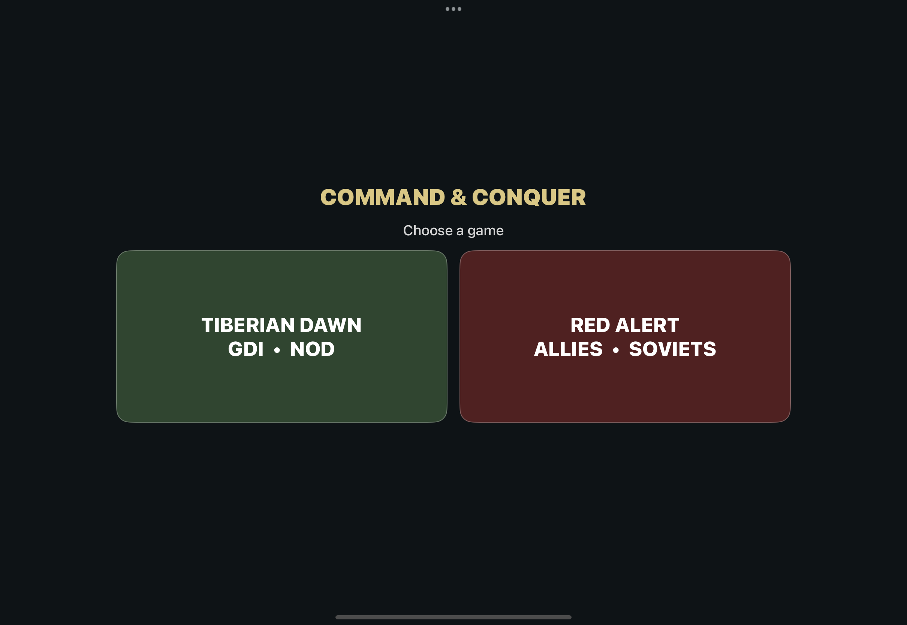

# Red Alert iOS integration — v0.7.5 bring-up

This is an engineering status record, not a playable v0.7.5 release. The planned product is one iOS app with a visual Tiberian Dawn / Red Alert choice, Allied and Soviet campaigns, skirmish, and multiplayer.



## Evidence so far

- The owner's local Red Alert archive contains separate Allied and Soviet CD images. Both are valid ISO 9660 images. The extracted `INSTALL/REDALERT.MIX` files match exactly; the discs have distinct `MAIN.MIX` files.
- `scripts/stage-redalert-ios-data.py` copies the common file and both disc-specific files to a private `RAData` directory and records sizes and SHA-256 hashes. The disc files are staged as `allied/MAIN.MIX` and `soviet/MAIN.MIX`, matching the engine's local-disc search. This data is not committed to Git.
- The existing `VanillaRA` engine compiled and linked as an unsigned arm64 iOS app after adding an iOS bridge, UIKit frameworks, and an explicit SDL entry point. The iPad simulator probe launched, played the original intro, and showed a Soviet battlefield scene after the movie. This is runtime evidence for loading and rendering those assets, but campaign selection, player controls, audio, saves, skirmish, and network sessions remain untested.
- `RED_ALERT_DATA_DIR` lets Xcode copy the private staged files into the Red Alert probe bundle. The device build's bundled files passed a byte-for-byte SHA-256 check. The iOS data path now reads those immutable files directly from the bundle, while `Documents/TiberianDawn/vanillara` keeps Red Alert saves apart from Tiberian Dawn saves. The engine's existing local-disc switcher can find both side folders; campaign switching still needs a runtime test.
- The installed Remastered Collection includes Red Alert texture archives. Their extraction and mapping to game sprites have not yet been done.
- An experimental combined iOS target is behind `RED_ALERT_COMBINED_APP`, off by default. It keeps Red Alert in a separately loaded dynamic library to isolate the engines' overlapping C++ globals. The iPad simulator displayed the Tiberian Dawn / Red Alert choice screen. The simulator-only Red Alert launch override then loaded that library from the app, found the bundled CD data, initialized SDL video, and played the Soviet intro. This verifies a same-app Red Alert startup path. It does not yet verify campaign selection, player controls, saves, or multiplayer.
- `TIBERIAN_DAWN_DATA_DIR` can add the original Tiberian Dawn data to that combined test bundle as `GameData`. With both data sets included, the iPad simulator also entered the Tiberian Dawn path and played its intro. All 20 Tiberian Dawn data files and all four staged Red Alert files matched their source SHA-256 hashes in the 1.9 GB combined simulator app. Neither game has been played through a mission in this combined build. No physical device has received it.

## Required integration work

1. Verify both choices in the combined app through actual mission play, and check that engine state, files, saves, and network rules stay separate. The chooser and both intro movies work in the simulator; this is an early integration test rather than a playable release.
2. Test Allied and Soviet disc selection in a running game and check campaign missions, movies, music, and saves against the original CD data.
3. Map the Red Alert Remastered assets and build a clear Allied/Soviet visual treatment for the selector and command deck.
4. Adapt the shared touch controls, production UI, radar, and laptop deck to Red Alert's units, structures, powers, and faction rules.
5. Verify skirmish and multiplayer with real devices; compiling the networking code does not establish working sessions.

## Local reproduction

Extract `MAIN.MIX` and `INSTALL/REDALERT.MIX` from each original disc into separate private directories. Then run:

```sh
python3 scripts/stage-redalert-ios-data.py <allied-dir> <soviet-dir> <private-RAData-dir>
cmake --preset ipados-redalert-probe -DRED_ALERT_DATA_DIR=<private-RAData-dir>
cmake --build --preset ipados-redalert-probe -- CODE_SIGNING_ALLOWED=NO CODE_SIGNING_REQUIRED=NO

# For a simulator startup check, use ipados-redalert-simulator in both commands.

# For the experimental combined app, configure the same simulator preset with
# BUILD_VANILLATD=ON, BUILD_VANILLARA=OFF, RED_ALERT_COMBINED_APP=ON,
# RED_ALERT_DATA_DIR=<private-RAData-dir>, and optionally
# TIBERIAN_DAWN_DATA_DIR=<private-vanillatd-dir>.
```

Do not commit `RAData`, CD images, signing material, or generated app bundles to the source tree.
