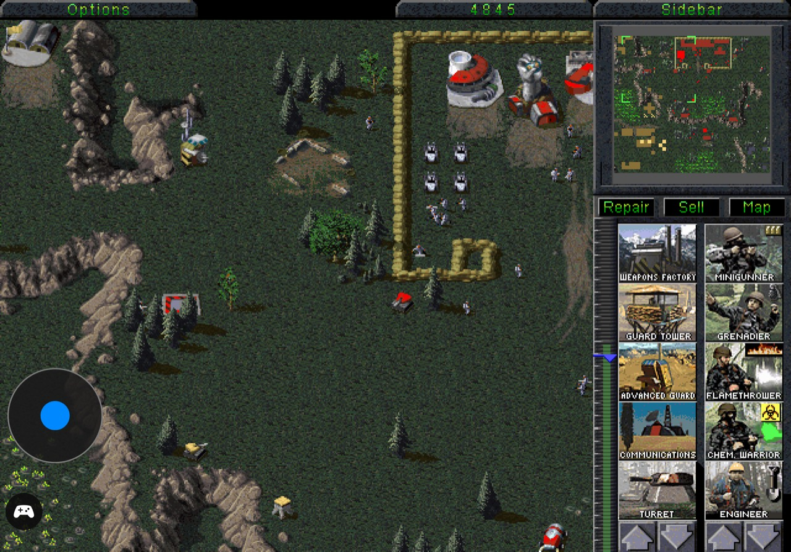

# Gameplay showcase

[Watch the Duo and iPad Pro 11 gameplay, campaign, and Workshop videos in your browser](https://wireproof.github.io/Tiberian-Dawn/). The player uses H.264/AAC fast-start MP4s with native playback controls.

The player source is [index.html](index.html); published media lives on the separate `gh-pages` branch to keep videos out of the main source checkout.

These are historical captures, not screenshots of the current v0.7.3 release. Version labels below come from a visible in-game version or an existing capture note; the date a file was added to Git does not establish the app build that produced it.

| Capture | Version shown or recorded |
| --- | --- |
| Duo cover main menu | **v0.5.2**, visible in the screenshot |
| iPad main menu, portrait and landscape | **v0.5.5**, visible in both screenshots |
| iPad Build Anywhere | **v0.5.7**, recorded with the capture |
| Other Duo and iPad screenshots | Exact build not recorded |
| HD gameplay images in the main README | Exact build not recorded; added October 26, 2026 |

For future screenshots, record the device, graphics mode, capture date, and version/build shown in the app alongside the image. A Git commit date alone is only a publication date.

## Cover display

### Cover Main Menu — v0.5.2

### Cover Workshop

### Cover Gameplay

## Inner display

### Inner Gameplay

### Inner Game Controls

### Inner Cheats

### Inner Options

### Inner Sidebar

## iPad Pro 11

Owner-supplied on October 26, 2026: 12 screenshots plus two browser-playable recordings. Both main-menu screenshots visibly show v0.5.5. The exact build for the other iPad captures is not recorded unless called out below. These document real-device gameplay and menus; they are not a complete compatibility test.

[Gameplay and controls (2:54)](https://wireproof.github.io/Tiberian-Dawn/#ipad-gameplay) · [Campaign and gameplay (1:05)](https://wireproof.github.io/Tiberian-Dawn/#ipad-campaign)

### Main menu — landscape, v0.5.5

### Gameplay — landscape

### Build Anywhere and customized build options — v0.5.7

Owner-supplied v0.5.7 screenshot. Shows existing Build Anywhere and Workshop customization; the dedicated Unlock GDI + Nod toggle is new in the next candidate.

### Orders and groups

### Cheats

### Zoom and joystick options

### Gameplay — portrait

### Portrait battlefield view

### Main menu — portrait, v0.5.5

### Workshop — portrait

### Workshop — landscape

### Workshop unit settings

