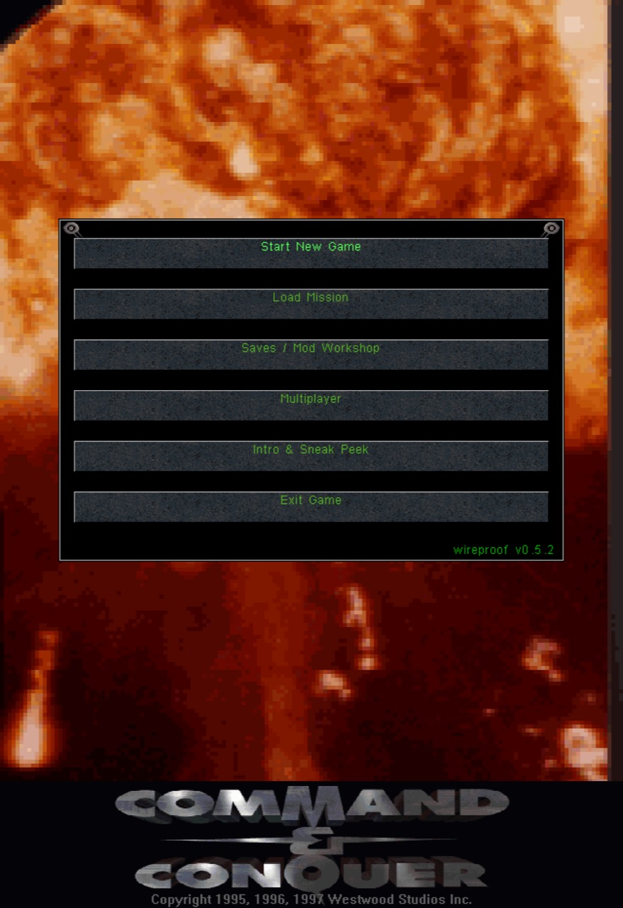
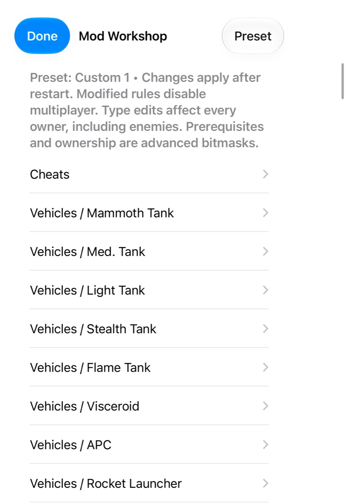
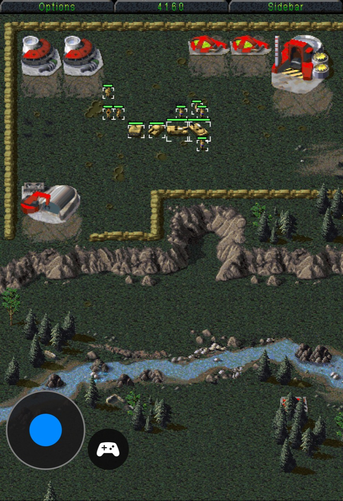
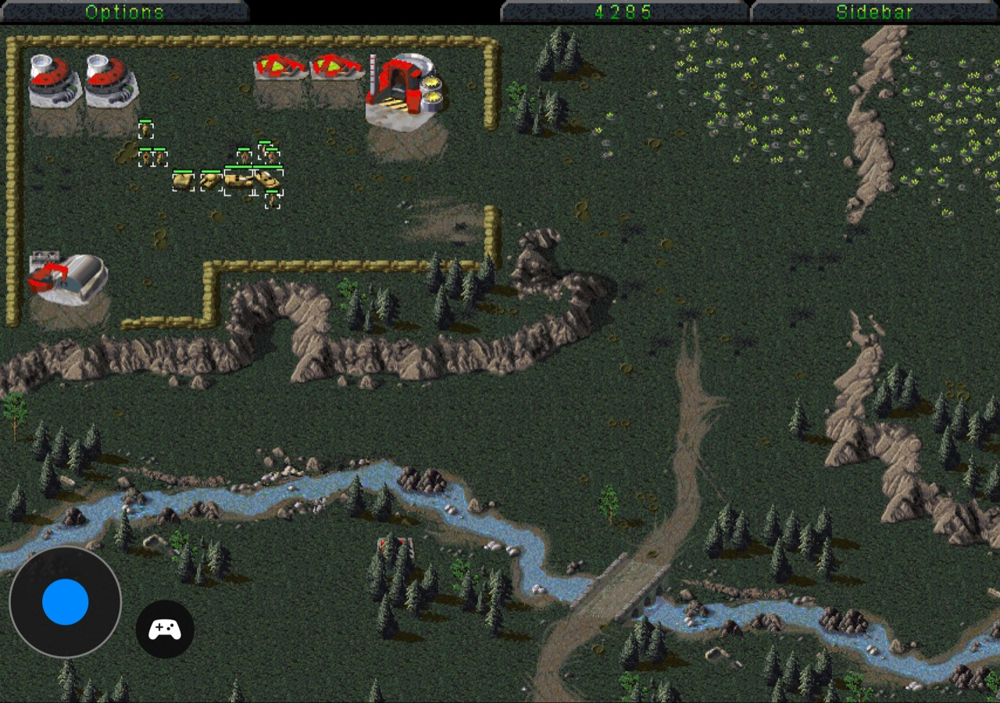
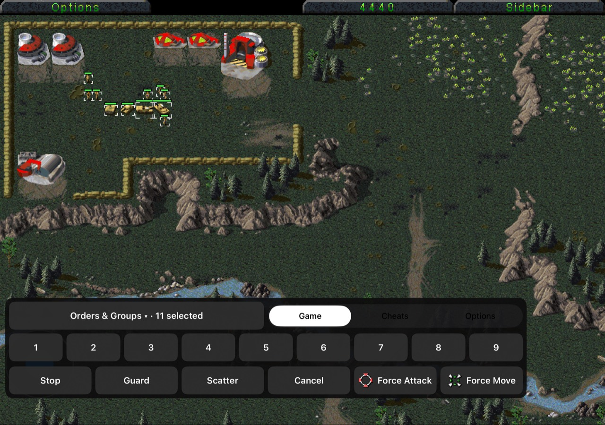
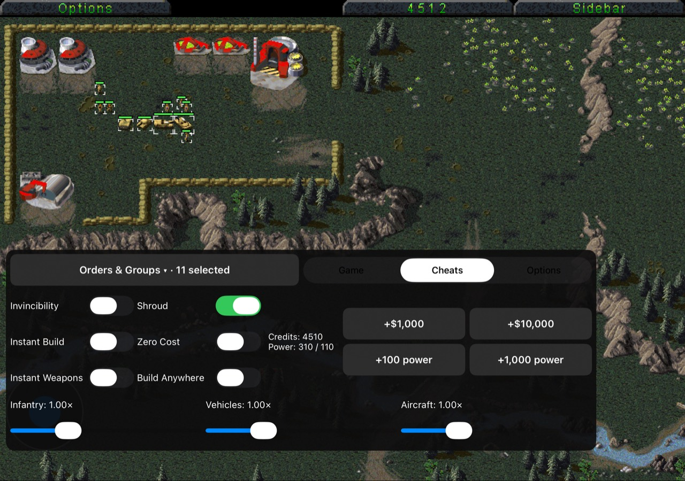
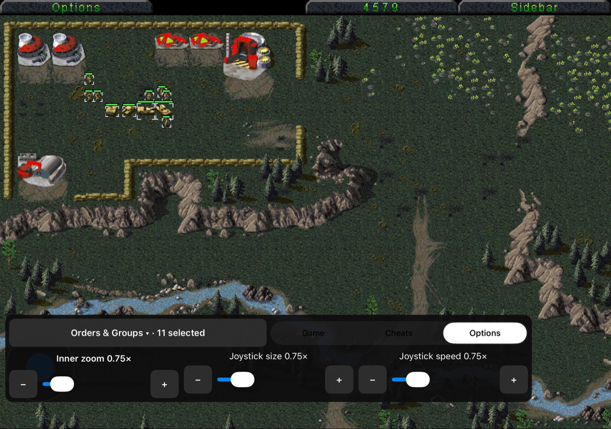
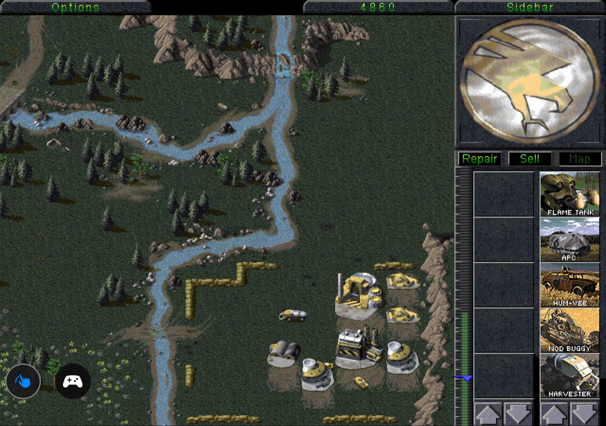

# Duo gameplay showcase

[Watch the cover, inner display, and Workshop videos in your browser](https://wireproof.github.io/Tiberian-Dawn/). The player uses H.264/AAC fast-start MP4s with native playback controls.

The player source is [index.html](index.html); published media lives on the separate `gh-pages` branch to keep videos out of the main source checkout.

User-supplied cover and inner display captures. The cover main menu identifies v0.5.2. These are gameplay examples, not verification of later fixes.

## Cover display

### Cover Main Menu

### Cover Workshop

### Cover Gameplay

## Inner display

### Inner Gameplay

### Inner Game Controls

### Inner Cheats

### Inner Options

### Inner Sidebar

