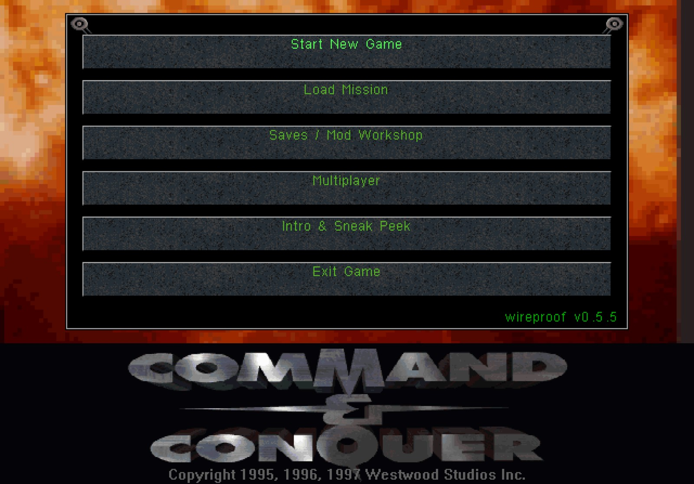
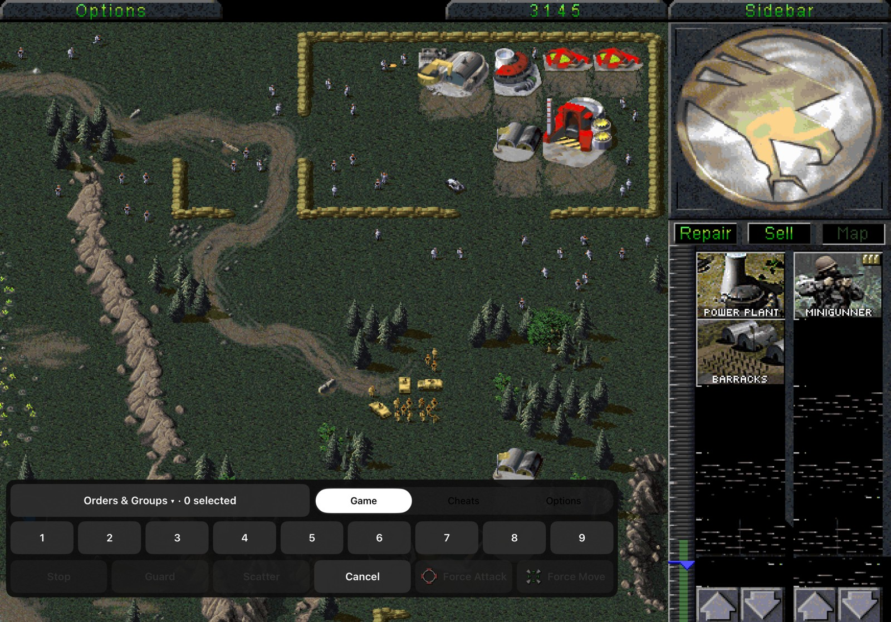
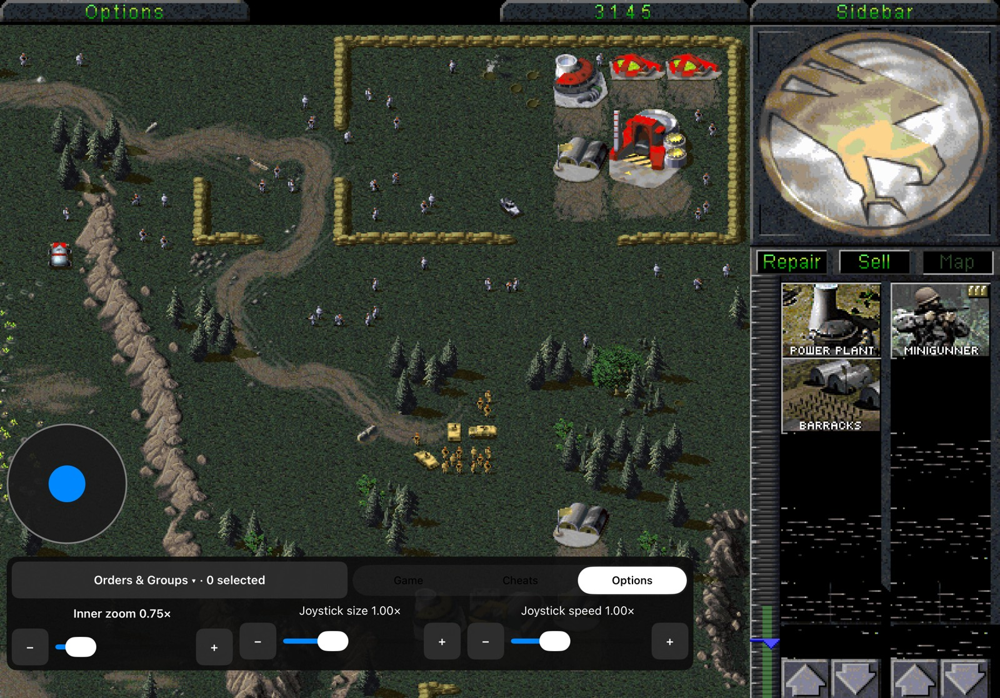
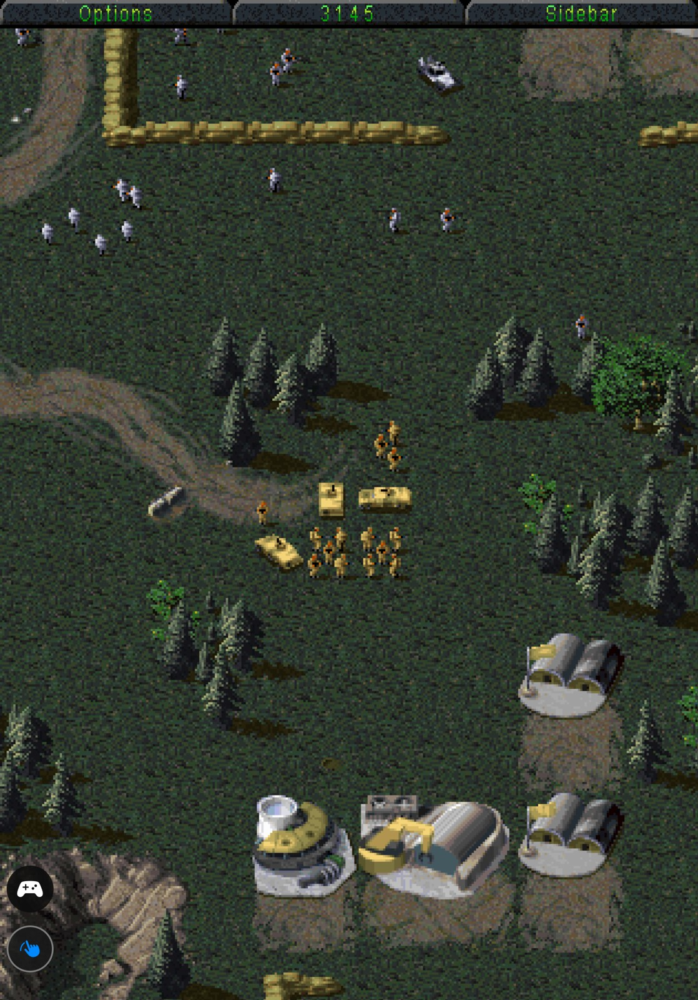
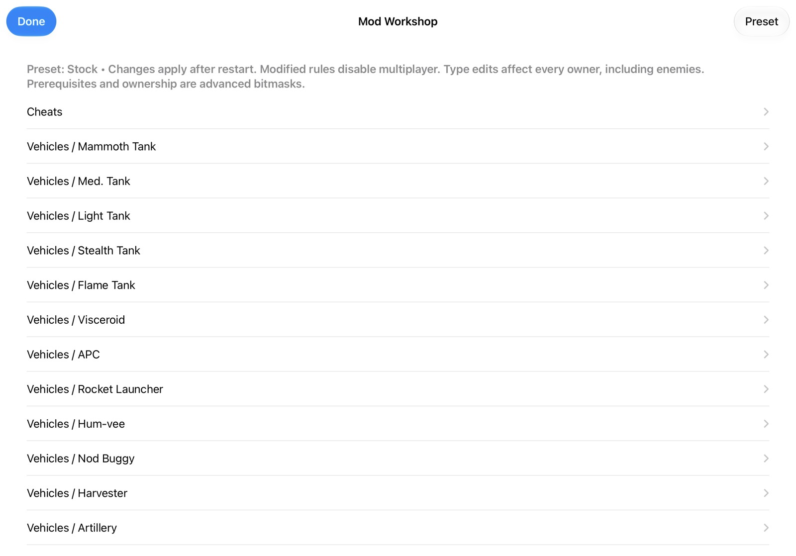
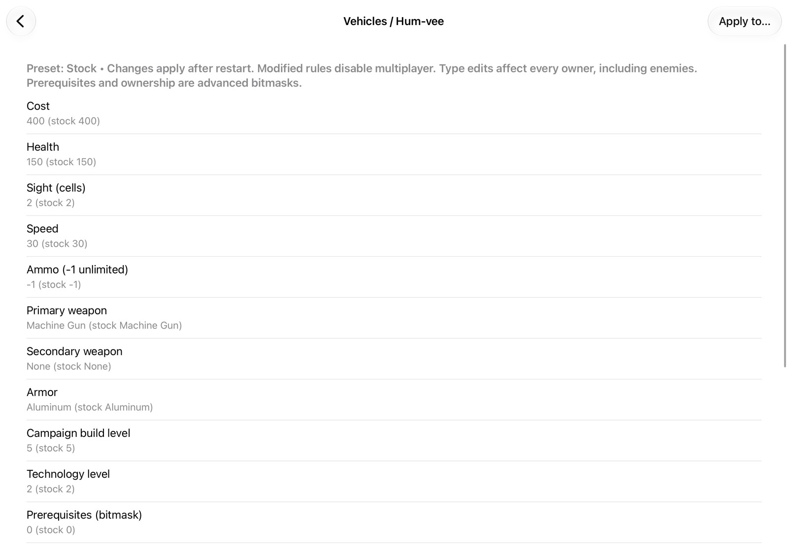

# Gameplay showcase

[Watch the Duo and iPad Pro 11 gameplay, campaign, and Workshop videos in your browser](https://wireproof.github.io/Tiberian-Dawn/). The player uses H.264/AAC fast-start MP4s with native playback controls.

The player source is [index.html](index.html); published media lives on the separate `gh-pages` branch to keep videos out of the main source checkout.

User-supplied cover and inner display captures. The cover main menu identifies v0.5.2. These are gameplay examples, not verification of later fixes.

## Cover display

### Cover Main Menu

### Cover Workshop

### Cover Gameplay

## Inner display

### Inner Gameplay

### Inner Game Controls

### Inner Cheats

### Inner Options

### Inner Sidebar

## iPad Pro 11

Owner-supplied on October 26, 2026: 11 screenshots plus two browser-playable recordings. These document real-device gameplay and menus; they are not a complete compatibility test.

[Gameplay and controls (2:54)](https://wireproof.github.io/Tiberian-Dawn/#ipad-gameplay) · [Campaign and gameplay (1:05)](https://wireproof.github.io/Tiberian-Dawn/#ipad-campaign)

### Main menu — landscape

### Gameplay — landscape

### Orders and groups

### Cheats

### Zoom and joystick options

### Gameplay — portrait

### Portrait battlefield view

### Main menu — portrait

### Workshop — portrait

### Workshop — landscape

### Workshop unit settings

